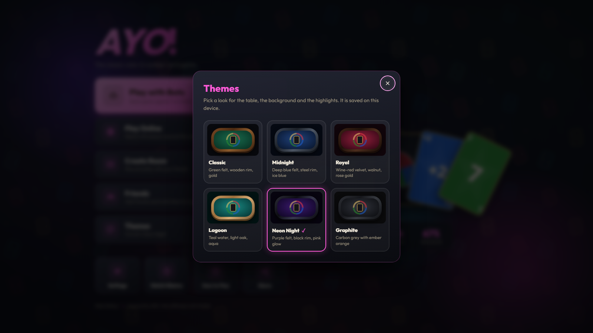
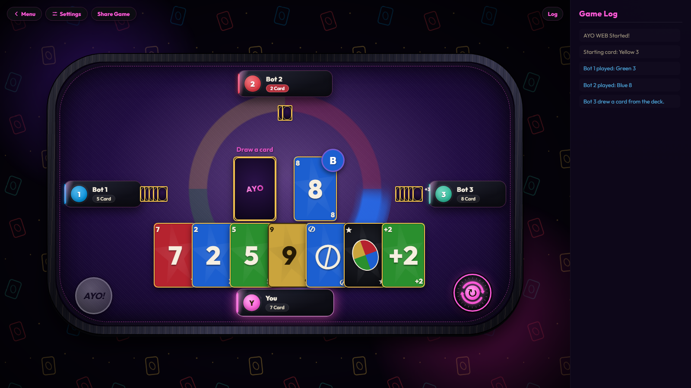

# Ayo Web (Türkçe)

Klasik UNO deneyiminden ilham alan modern, tarayıcı tabanlı bir kart oyunu.

HTML, CSS ve JavaScript ile geliştirildi; online özellikler için küçük bir Node.js sunucusu kullanıyor. **Ayo Web**'de botlara karşı oynayabilir, arkadaş ekleyip canlı davet gönderebilir, altı farklı masa teması arasından seçim yapabilirsin. Kafe tarzı müzik ve akıcı animasyonlarla hem masaüstünde hem mobilde çalışır.

> For English: [README.md](README.md)

## Özellikler

**Oynanış**
- Hızı ayarlanabilen 1–3 bota karşı oyun
- Renk Değiştirme ve +4 kartları (ikisi de her zaman atılabilir), +2 / +4 üst üste koyma, Pas, Yön Değiştirme
- **AYO butonu**: tek kartın kaldığında AYO demelisin, demezsen +1 kart çekersin. İki kartın varken önceden basabilir ya da sondan bir önceki kartını attıktan sonraki kısa geri sayımda basabilirsin. Botlar da bazen unutur.
- Oynanan renk, masanın ortasındaki halkada parlar
- Geriye kaydırıp okunabilen tam oyun günlüğü (log)

**Arkadaşlar (sunucu gerekir)**
- Arkadaş kodları (`AYO-XXXX`), arkadaşlık istekleri ve bekleyen istekler listesi
- Online durumu, arkadaş listesinden cevaplanan oyun davetleri
- Arkadaş profilleri: çevrimiçi / son görülme ve maç istatistikleri

**Görünüm ve ses**
- Altı tema: Classic, Midnight, Royal, Lagoon, Neon Night, Graphite (masa, kenar, arka plan, vurgu rengi)
- Ses efektleri ve iki fon müziği (menü ve oyun). Hepsi Web Audio API ile tarayıcıda üretilir: ses dosyası yok, telifli örnek yok
- Arayüz boyutu, ses / müzik / ses seviyesi ayarları, maç geçmişi ve istatistikler

## Proje Yapısı

``` text
Ayo-Web/
├── server.js           # Node.js sunucusu: public/ klasörünü sunar + online özellikler (Socket.IO)
├── package.json        # Sunucu paketleri (express, socket.io)
├── web-launcher.bat    # Windows: paketleri kurar (ilk seferde) ve sunucuyu başlatır
├── data/               # Sunucu çalışırken oluşturur (git'e girmez): oyuncular, arkadaşlar, istekler
├── public/
│   ├── index.html      # Ana menü
│   ├── menu.js         # Menü: paneller, ayarlar, arkadaşlar, profiller, temalar
│   ├── menu.css        # Menü stilleri
│   ├── game.html       # Oyun sayfası
│   ├── app.js          # Oyun mantığı, botlar, AYO kuralı, animasyonlar
│   ├── style.css       # Oyun stilleri
│   ├── themes.css      # Tema renkleri (masa, kenar, arka plan, vurgu)
│   ├── audio.js        # Tarayıcıda üretilen ses efektleri ve fon müziği
│   ├── online.js       # Sunucu bağlantısı: online durum, arkadaşlık istekleri, oyun davetleri
│   ├── settings.js     # Ayarlar, profil, arkadaşlar ve maç geçmişi (localStorage)
│   ├── bg-pattern.svg  # Arka plan deseni
│   └── _headers        # Cloudflare Pages için güvenlik başlıkları
├── Screenshots/
├── README.md
└── README_TR.md
```

## Kullanılan Teknolojiler

-   HTML5, CSS3, JavaScript (ES2020)
-   Web Audio API (ses efektleri ve müzik)
-   Node.js, Express, Socket.IO (online özellikler)

## Kurulum

``` bash
git clone https://github.com/<kullanıcı-adınız>/ayo-web.git
cd ayo-web
```

[Node.js](https://nodejs.org) (18 veya üstü) kurun, ardından Windows'ta `web-launcher.bat` dosyasını çalıştırın.

Alternatif olarak:

``` bash
npm install
npm start
```

Oyun http://localhost:8001 adresinde açılır. Aynı Wi-Fi'deki telefonlar bilgisayarın yerel IP adresiyle bağlanabilir (launcher bu adresi ekrana yazar).

`public/` klasörünü sıradan bir statik sunucuyla açmak da çalışır, ama o zaman arkadaşlık istekleri ve davetler çevrimdışı kalır.

### Birden fazla hesapla test etme

Her hesap, tarayıcının o adres için tuttuğu depolamada durur. Bu yüzden tek bilgisayarda birden fazla hesap açabilirsin: `http://localhost:8001`, `http://127.0.0.1:8001`, yerel IP adresin, gizli pencere ya da başka bir tarayıcı ayrı oyuncular olarak sayılır.

## Yayınlama (Cloudflare Pages)

Cloudflare Pages statik dosya barındırır, bu yüzden sadece **`public/`** klasörü yayınlanır. Pages'te oyun çevrimdışı modda çalışır: botlar, temalar, müzik ve AYO kuralı çalışır; arkadaş özellikleri ise Node sunucusu gerektirdiği için kapalı kalır.

- **GitHub üzerinden (önerilen):** Workers & Pages → Create → Pages → depoyu bağla. Framework preset: *None*, build command: *boş*, build output directory: **`public`**.
- **Sürükle-bırak:** sadece `public` klasörünü yükle. Proje klasörünün tamamı yüklenmez: yalnızca `node_modules` içinde yaklaşık 1.000 dosya var ve panelden yükleme 1.000 dosyada sınırlı.

`public/_headers`, yerelde `server.js`'in gönderdiği güvenlik başlıklarını Pages'te de ekler.

## Ekran Görüntüleri

### Masaüstü





### Mobil

<p>
  
  
</p>

## Yol Haritası

### Oynanış

-   [x] Renk Değiştirme (Wild Card)
-   [x] +4 Kartı (Wild Draw 4)
-   [x] "AYO" Butonu ve Ceza Sistemi
-   [ ] Özel Oyun Kuralları

### Çok Oyunculu

-   [x] Arkadaş Sistemi (arkadaşlık istekleri, online durum, oyun davetleri)
-   [x] Arkadaş Profilleri
-   [ ] Çevrimiçi Maçlar
-   [ ] Özel Odalar
-   [ ] Dereceli Eşleştirme

### Oyuncu İlerlemesi

-   [x] Maç Geçmişi ve İstatistikler
-   [ ] Başarımlar

### Diğer

-   [x] Temalar
-   [x] Fon Müziği
-   [ ] Daha Fazla Dil Desteği

## Lisans

Bu proje eğitim amacıyla paylaşılmaktadır.

## Uyarı

Bu proje, UNO'dan ilham alınarak kendimi geliştirmek için yaptığım bir projedir. UNO, Mattel'in tescilli ticari markasıdır. Bu proje Mattel ile bağlantılı değildir ve Mattel tarafından desteklenmemektedir.
