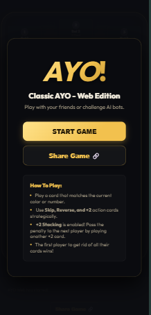
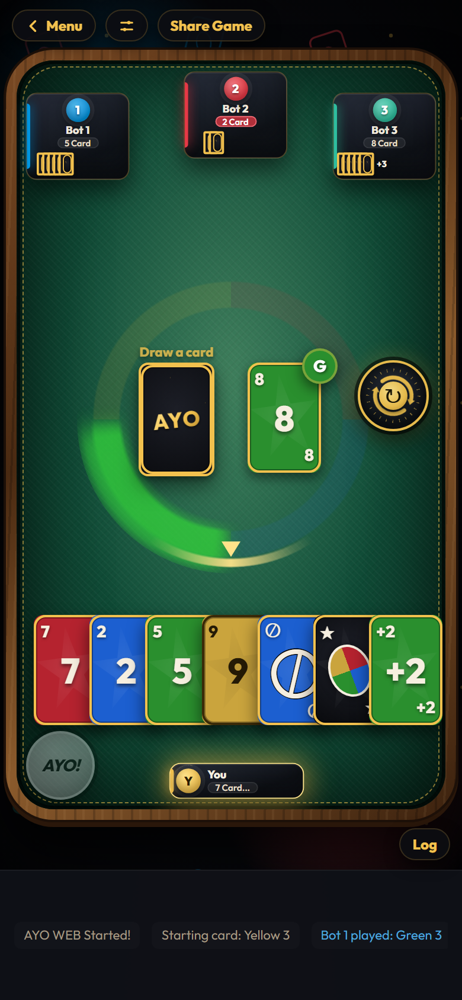
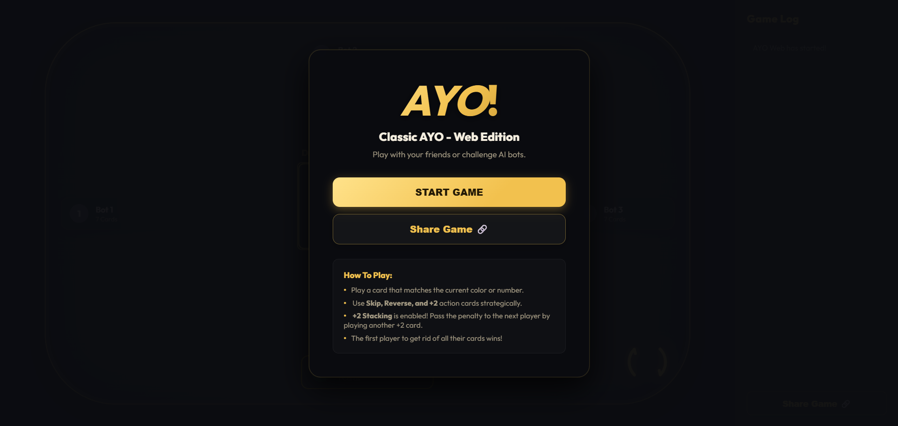
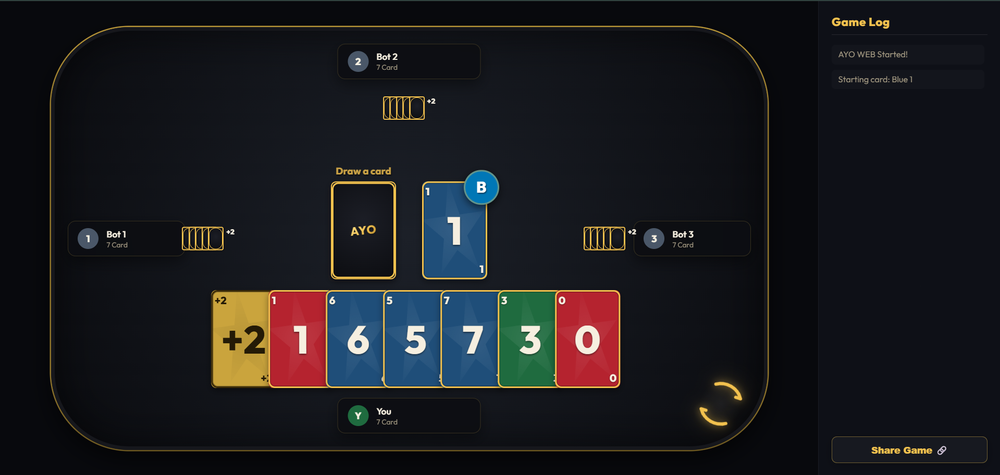

# Ayo Web (Türkçe)

Klasik UNO deneyiminden ilham alan modern, tarayıcı tabanlı bir kart
oyunu.

HTML, CSS ve JavaScript kullanılarak geliştirilen **Ayo Web**; mobil ve
masaüstü uyumluluğu, yapay zekâ rakipleri, akıcı animasyonları ve modern
kullanıcı arayüzüyle hızlı ve eğlenceli bir oyun deneyimi sunmayı
amaçlamaktadır.

## Proje Yapısı

``` text
Ayo-Web/
├── app.js            # Oyun mantığı
├── style.css         # Stil dosyaları
├── index.html        # Ana sayfa
├── web_launcher.bat  # Yerel sunucuyu başlatır
└── README.md
```

## Özellikler

-   ✔ Mobil cihaz desteği
-   ✔ Masaüstü desteği
-   ✔ Yapay zekâ rakipleri
-   ✔ Akıcı animasyonlar
-   ✔ Ses efektleri
-   ✔ Responsive tasarım

## Kullanılan Teknolojiler

-   HTML5
-   CSS3
-   JavaScript (ES6)

## Kurulum

``` bash
git clone https://github.com/<ardaylmz30>/AYO-Web.git
cd AYO-Web
```

Windows'ta `web-launcher.bat` dosyasını çalıştırın.

Alternatif olarak:

``` bash
python3 -m http.server 8001
```

## Canlı Demo

https://green-bird-8b2f.arda-ylmz2005-02.workers.dev/

## Ekran Görüntüleri






## Yol Haritası

### Oynanış

-   [ ] Renk Değiştirme (Wild Card)
-   [ ] +4 Kartı (Wild Draw 4)
-   [ ] "AYO" Butonu ve Ceza Sistemi

### Çok Oyunculu

-   [ ] Çevrimiçi Çok Oyunculu
-   [ ] Özel Odalar
-   [ ] Arkadaş Sistemi
-   [ ] Dereceli Eşleştirme

### Oyuncu İlerlemesi

-   [ ] Oyuncu Profilleri
-   [ ] İstatistikler
-   [ ] Başarımlar

### Diğer

-   [ ] Daha Fazla Dil Desteği
-   [ ] Özel Oyun Kuralları

## Lisans

Bu proje eğitim amacıyla paylaşılmaktadır.

## Uyarı

- Bu proje UNO'dan ilham alınarak geliştirilmiş kendimi geliştrimek için yaptığım bir projedir. UNO, Mattel'in tescilli ticari markasıdır. Bu proje Mattel ile bağlantılı değildir.
